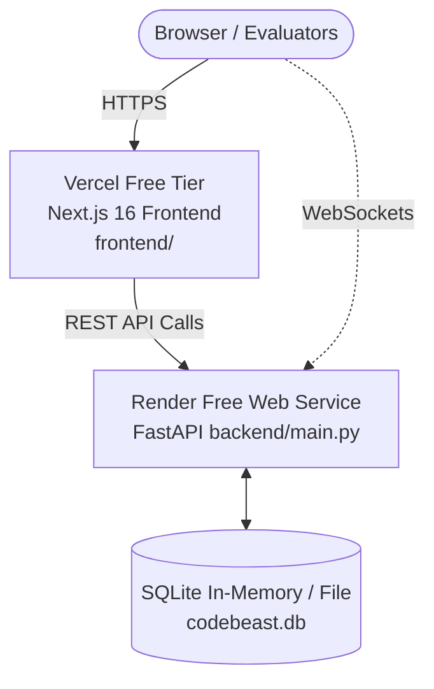

# 🚀 Code Beast AI — 100% Free Production Deployment Guide ($0 / No Credit Card)

This guide shows you how to deploy the entire Code Beast AI platform for **100% FREE** with **zero payment information or credit card required**:
- **Frontend**: Hosted on **Vercel** (Free forever, global edge CDN).
- **Backend API**: Hosted on **Render.com** (Free Web Service tier).

---

## 🏗️ Architecture Overview

---

## ⚡ Step-by-Step 100% Free Deployment

---

### PART 1: Deploy Backend on Render (100% Free · No Card Needed)

#### Method 1: Via Web Service (Recommended)
1. Go to [dashboard.render.com](https://dashboard.render.com/) and click **New +** → **Web Service** *(do NOT select Blueprint to avoid card prompts)*.
2. Select your repository: **`ibanmondal/CODE-BEAST-AI`**.
3. Configure the fields:
   - **Name**: `codebeast-api`
   - **Region**: Any close region (e.g., Singapore, Frankfurt, Oregon)
   - **Branch**: `main`
   - **Root Directory**: `backend` 👈
   - **Runtime**: `Python 3`
   - **Build Command**: `pip install -r requirements.txt`
   - **Start Command**: `uvicorn main:app --host 0.0.0.0 --port $PORT`
   - **Instance Type**: Select **Free** ($0 / month) 👈
4. Under **Environment Variables**, add:
   - `GROQ_API_KEY`: *(Your key from console.groq.com)*
   - `GITHUB_TOKEN`: *(Your GitHub PAT)*
   - `PYTHON_VERSION`: `3.11.9`
5. Click **Deploy Web Service**.
6. Once deployed, copy your free backend URL (e.g. `https://codebeast-api.onrender.com`).

---

### PART 2: Deploy Frontend on Vercel (100% Free)

1. Go to [vercel.com/new](https://vercel.com/new) and log in with GitHub.
2. Click **Import** next to **`ibanmondal/CODE-BEAST-AI`**.
3. In the configuration window:
   - **Framework Preset**: `Next.js` (auto-detected)
   - **Root Directory**: Click **Edit** and choose **`frontend`** 👈 *(Crucial!)*
4. Under **Environment Variables**, add:
   - `NEXT_PUBLIC_API_URL` = `https://codebeast-api.onrender.com` *(Your Render backend URL from Part 1, without a trailing slash)*
   - `NEXT_PUBLIC_WS_URL` = `wss://codebeast-api.onrender.com`
5. Click **Deploy**.
6. In ~60 seconds, your frontend will be live on Vercel at `https://code-beast-ai.vercel.app`!

---

## 🔍 Verification

1. Backend Health: `https://your-render-url.onrender.com/health` returns `{"status": "ok"}`
2. Frontend Dashboard: Open your Vercel URL and check that repository rankings, Trophy Hall (`/judges`), and Leaderboard load.
3. Certificate Generator: Open any certificate on `/judges` and click **Download Official PDF** or **Print Certificate**.
