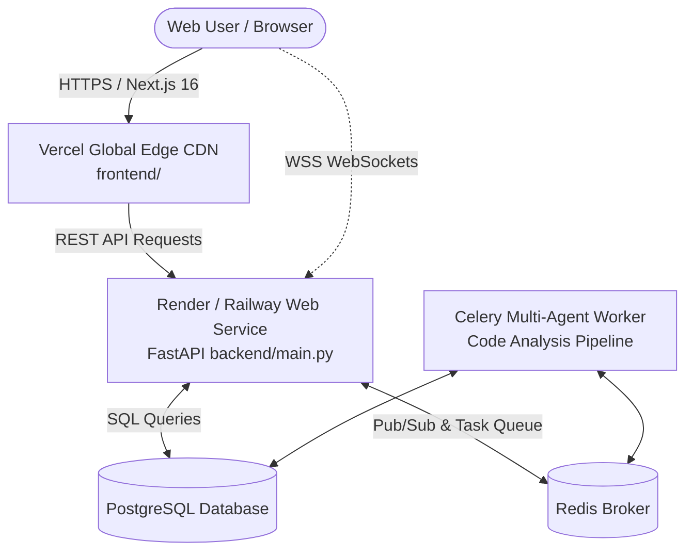

# 🚀 Code Beast AI — Deployment Guide: Vercel + Render / Railway

This guide walks you through deploying **Code Beast AI** with the optimal production stack:
- **Frontend Dashboard**: Hosted on **Vercel** (Global Edge CDN, instantaneous page transitions, custom domain support).
- **Backend API & Multi-Agent Worker**: Hosted on **Render** (or **Railway**) with managed Redis & PostgreSQL.

---

## 🏗️ Architecture Overview

---

## ⚡ Quick 2-Part Deployment Walkthrough

---

### PART 1: Deploy the Backend (FastAPI + Redis + Celery + DB)

You can choose either **Render** or **Railway**.

#### Option A: Using Render.com (Recommended 1-Click)
1. Go to [dashboard.render.com](https://dashboard.render.com/) and sign in with GitHub.
2. Click **New +** → **Blueprint**.
3. Select your repository: **`ibanmondal/CODE-BEAST-AI`**.
4. Render will read the root `render.yaml` and automatically configure:
   - `codebeast-api` (FastAPI Web Service)
   - `codebeast-worker` (Celery background evaluation worker)
   - `codebeast-redis` (In-memory broker)
   - `codebeast-db` (PostgreSQL)
5. Fill in the required environment variables:
   - `GROQ_API_KEY`: Your key from [console.groq.com](https://console.groq.com)
   - `GITHUB_TOKEN`: Your GitHub Personal Access Token (PAT)
6. Click **Apply**.
7. Once deployed, note your FastAPI backend URL (e.g., `https://codebeast-api.onrender.com`).

#### Option B: Using Railway.app
1. Go to [railway.app](https://railway.app/) and sign in with GitHub.
2. Click **New Project** → **Deploy from GitHub repo** → select `ibanmondal/CODE-BEAST-AI`.
3. Add a **Redis** service (`+ New` → `Database` → `Redis`).
4. Add a **PostgreSQL** service (`+ New` → `Database` → `PostgreSQL`).
5. In the backend service settings:
   - **Root Directory**: `backend`
   - **Start Command**: `uvicorn main:app --host 0.0.0.0 --port $PORT`
   - Set variables: `GROQ_API_KEY`, `GITHUB_TOKEN`, `DATABASE_URL`, `REDIS_URL`.
6. Generate a public domain under **Networking** (e.g., `https://codebeast-backend.up.railway.app`).

---

### PART 2: Deploy the Frontend on Vercel

1. Go to [vercel.com/new](https://vercel.com/new).
2. Click **Import** next to your GitHub repository: **`ibanmondal/CODE-BEAST-AI`**.
3. In the project configuration page:
   - **Project Name**: `codebeast-ai` (or your preferred name)
   - **Framework Preset**: `Next.js` (auto-detected)
   - **Root Directory**: Click **Edit** and select **`frontend`** 👈 *(Crucial Step!)*
4. Under **Environment Variables**, add:
   | Key | Value | Notes |
   | :--- | :--- | :--- |
   | `NEXT_PUBLIC_API_URL` | `https://your-backend-url.onrender.com` | Your deployed FastAPI URL (no trailing slash) |
   | `NEXT_PUBLIC_WS_URL` | `wss://your-backend-url.onrender.com` | WebSocket secure protocol `wss://` |
5. Click **Deploy**.
6. In about 60 seconds, your site will be live at `https://codebeast-ai.vercel.app`! 🎉

---

## 🔍 Post-Deployment Verification Checklist

Once both services are deployed:
1. **API Health**: Visit `https://your-backend-url/health` → Should return `{"status": "ok"}`.
2. **API Interactive Docs**: Visit `https://your-backend-url/docs` → Swagger UI should load.
3. **Frontend Dashboard**: Visit your Vercel URL → Metrics, graphs, and leaderboard load automatically.
4. **Certificate Test**: Navigate to `/judges`, click **View Official Certificate**, and test:
   - **Download Official PDF**: Downloads clean 300 DPI A4 Landscape PDF.
   - **Print Certificate**: Opens isolated print preview with full gold borders and signatures.
5. **Real-time Evaluation**: Try running an evaluation on `/analysis` or `/upload` to verify Celery agent execution and live streaming.
