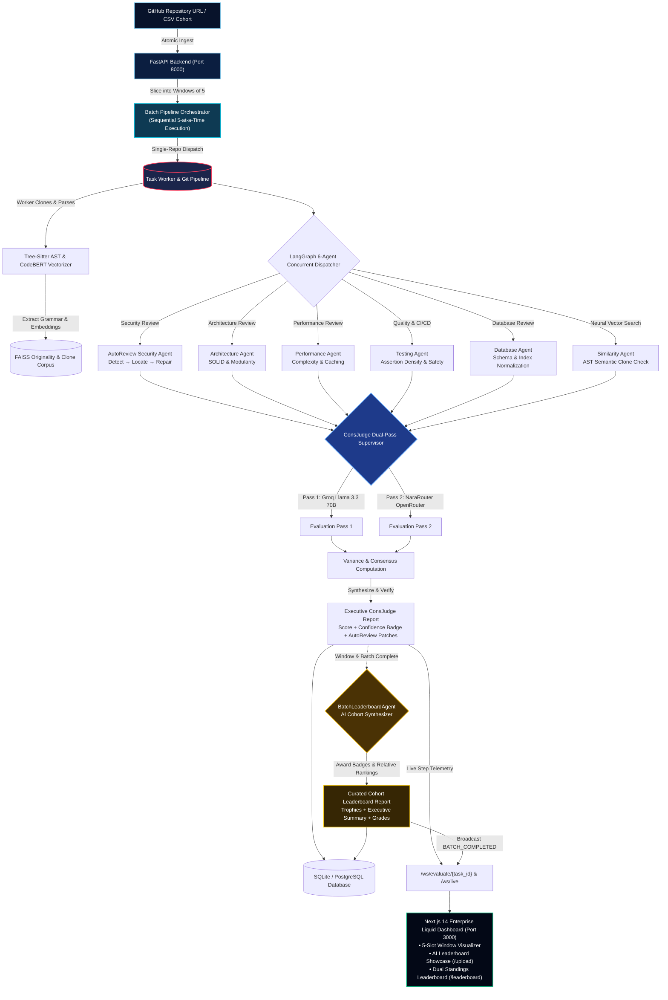

<div align="center">
  <h1>⚡ CodeBeast AI ⚡</h1>
  <p><strong>Enterprise Software Intelligence & Multi-Agent Repository Evaluation Platform</strong></p>
  <p><em>Engineered for Technical Hiring, Hackathon Cohort Judging, and Automated AST-Powered Code Audits</em></p>

  <p>
    <a href="#-key-features--capabilities">Features</a> •
    <a href="#-research-backed-advancements">Research Foundations</a> •
    <a href="#-system-architecture">Architecture</a> •
    <a href="#-model--inference-stack">Model Stack</a> •
    <a href="#-quickstart">Quickstart</a> •
    <a href="#-api-endpoints">API Reference</a> •
    <a href="#-automated-verification-suite">Verification Suite</a>
  </p>

  <p>
    
    
    
    
    
    
    
    
    
    
  </p>
</div>

---

## 🚀 Key Features & Capabilities

### 1. Multi-Agent Autonomous Evaluation Pipeline
CodeBeast AI runs 6 specialized agent nodes concurrently over a Tree-Sitter parsed repository:
- **AutoReview Security Agent**: Classifies CWE taxonomy (CWE-89, CWE-798, CWE-78), locates vulnerable AST coordinate spans, and generates actionable unified git diff repairs.
- **Architecture & Modularity Agent**: Evaluates SOLID principles, package modularity, separation of concerns, and dependency inversion.
- **Performance & Algorithmic Agent**: Analyzes asymptotic time/space complexity, async non-blocking I/O primitives, and resource caching.
- **Testing & QA Agent**: Analyzes test assertion density, pytest/jest frameworks, CI/CD regression safety, and branch coverage.
- **Database & Persistence Agent**: Inspects relational schema normalization, index boundaries, ORM query patterns, and connection pooling.
- **Semantic Originality & Clone Vector Engine**: Normalizes AST syntax trees with Tree-Sitter and computes CodeBERT / MiniLM vector embeddings against template corpora to calculate a true **Originality Score (0–100)** and flag boilerplate clones.

### 2. ConsJudge: Dual-Pass Inter-Judge Consensus
Single LLM passes often suffer from hallucinated variance and prompt sensitivity. CodeBeast AI deploys **ConsJudge**, a dual-pass supervisor system:
- Runs independent evaluation passes across different high-capacity foundation models (Groq Llama 3.3 70B & NaraRouter Claude/GPT-4o).
- Calculates the inter-judge variance margin ($\pm \text{points}$) and statistical agreement.
- Issues certified **ConsJudge Verified Confidence Badges**:
  - `HIGH_CONFIDENCE` (variance $\le 2.0$ points)
  - `MODERATE_CONFIDENCE` (variance $\le 4.0$ points)
  - `LOW_CONFIDENCE` (re-evaluation recommendation)

### 3. True Real-Time WebSocket Telemetry
- Replaced synthetic mock client timers with live bidirectional WebSockets (`/ws/evaluate/{task_id}` and `/ws/live`).
- Streams real task state changes, AST clone scan progress, agent execution thoughts, and ConsJudge consensus events directly from the Celery worker pool to the frontend.

### 4. 5-at-a-Time Sequential Window Batch Pipeline (`POST /api/v1/evaluate/bulk`)
- **Controlled 5-Repo Windowing**: Ingests batches of any size (from 5 to 500+ repositories) and slices them into sequential chunks of 5.
- **Zero Resource Contention**: Evaluates each repository one-by-one within the active window. This eliminates git workspace lock contention, prevents out-of-memory crashes, and respects LLM rate limits.
- **Real-Time Step Tracker UI**: The `/upload` interface displays an interactive 5-slot pipeline tracker showing live progress (`Waiting`, `Analyzing AST & Agents...`, `Completed`) for each repository in the current window.
- **Batch State Persistence**: Tracks chunk progress (`current_chunk / total_chunks`) in the database (`BatchEvaluation`), broadcasting real-time WebSocket events (`BATCH_CHUNK_STARTED`, `BATCH_ITEM_EVALUATING`, `BATCH_ITEM_COMPLETED`, `BATCH_LEADERBOARD_SYNTHESIZING`, `BATCH_COMPLETED`).

### 5. Autonomous Batch Leaderboard Agent (`BatchLeaderboardAgent`)
- **End-of-Batch AI Synthesis**: Once the final 5-repo window finishes, the specialized `BatchLeaderboardAgent` automatically activates.
- **Deep Comparative Analysis**: Gathers all evaluation metrics, security audits, architecture ratings, and originality scores across the entire batch cohort.
- **Honor Badges & Distinctions**:
  - 🏆 **Grand Champion**: Highest overall multi-agent score.
  - 🛡️ **Hardened Fortress**: Best security posture & zero critical CWEs.
  - 🏛️ **Architecture Vanguard**: Cleanest modular design & SOLID adherence.
  - 💎 **Originality Titan**: Highest CodeBERT AST originality & lowest clone vector.
  - 📈 **Most Improved / Resilient**: Best error handling & test coverage.
- **Cohort Intelligence**: Synthesizes an executive overview, systemic strengths, and critical areas for cohort growth.
- **Dual-Layer Architecture**: Powered by Groq LLMs with an automated deterministic mathematical fallback engine, guaranteeing reliable rankings even during API provider outages.

### 6. Dynamic Submitter & Organization Mapping
- Automatically extracts the real GitHub organization or developer username (`https://github.com/:owner/:repo`) directly from the repository target.
- Associates proper team names dynamically across batch uploads, leaderboards, and reports rather than using static hardcoded placeholders.

### 7. Clean, Bulleted Executive Audits
- Generates structured, readable executive summaries formatted in clean bullet points for strengths, security alerts, and architectural weaknesses.
- Provides downloadable JSON & Markdown audit reports ready for hackathon judges and technical recruiters.

### 8. Repo Duel: Head-to-Head Architectural Comparison
- Compare two candidate or student repositories side-by-side.
- Renders 6-dimensional radar charts, metric deltas, and automated tie-breaking with ConsJudge synthesis.

### 9. Dual-View Leaderboard Experience (`/leaderboard`)
- **Global Standings**: Persistent all-time leaderboard showing all evaluated repositories with filtering, search, and ConsJudge confidence filters.
- **AI Batch Cohort Standings**: Dedicated view powered directly by the `BatchLeaderboardAgent`, rendering honor badge trophy cards, AI executive commentary, and comparative cohort standings.

---

## 🔬 Research-Backed Advancements

| # | Research Foundation | Problem Solved | Implementation in CodeBeast AI |
|---|---|---|---|
| **1** | **ConsJudge: Multi-Pass Consensus** (*LLM-as-a-Judge Consistency*) | Unverified, hallucinated single-pass scores | Runs dual concurrent supervisor passes (NaraRouter Agnes + Groq Llama 3.3). Computes variance margin ($\pm \text{points}$) and issues a certified **ConsJudge Verified Confidence Badge** (High / Moderate / Low). |
| **2** | **ASTNN & CodeBERT Neural Embeddings** (*Semantic Clone Detection*) | Fragile commit heuristics that fail on copy-paste code | Extracts Tree-Sitter normalized AST syntax trees and computes CodeBERT semantic embeddings with FAISS vector similarity to calculate a true **Originality Score (0-100)** and detect template clones. |
| **3** | **AutoReview: 3-Stage Pipeline** (*ACM FSE 2025: Detect → Locate → Repair*) | Shallow, single-pass security reviews with no actionable fixes | **Detect**: Classifies CWE taxonomy (CWE-89, CWE-798, CWE-78).<br>**Locate**: Pinpoints exact file coordinates and exploit vectors.<br>**Repair**: Generates unified git diffs and defensive test guidance. |

---

## 🏗️ System Architecture



---

## 🧠 Model & Inference Stack

CodeBeast AI is powered by high-throughput foundation models through optimized provider routing:

- **Groq Cloud API**:
  - Primary Model: `llama-3.3-70b-versatile` (ultra-low-latency 300+ tok/s evaluation for security, architecture, and synthesis).
  - Fast Model: `llama-3.1-8b-instant` (sub-second Tree-Sitter AST preprocessing & metadata indexing).
  - Multi-key failover with automatic rotation across `GROQ_FALLBACK_KEYS`.
- **NaraRouter (OpenRouter-Compatible Gateway)**:
  - Multi-model supervisor pass and cross-provider consensus verification.
  - Fallback models: Claude 3.5 Sonnet, GPT-4o, and Llama 3.3.
- **Local Neural Embeddings**:
  - Sentence-Transformers `all-MiniLM-L6-v2` & CodeBERT embeddings for offline AST semantic clone detection without cloud egress.

---

## ⚡ Quickstart

### Option A: One-Click Runner (Windows PowerShell / Batch)

Launch the entire stack (FastAPI backend, Celery worker with 4 threads, and Next.js frontend) with one command:

```powershell
# Windows PowerShell
.\run_all.ps1

# Or Windows Command Prompt / Batch
run_all.bat
```

Services will be online at:
* **Frontend Dashboard:** [http://localhost:3000](http://localhost:3000)
* **Bulk Ingestion (CSV):** [http://localhost:3000/upload](http://localhost:3000/upload)
* **Live Agent Monitor:** [http://localhost:3000/live](http://localhost:3000/live)
* **Backend OpenAPI Docs:** [http://localhost:8000/docs](http://localhost:8000/docs)

---

### Option B: Docker Compose (Production & Cloud)

Run the full multi-container production stack (PostgreSQL 15, Redis 7, FastAPI Backend, Celery Distributed Worker, and Next.js 16 Edge UI):

```bash
docker compose -f docker-compose.prod.yml up -d --build
```

#### ⚡ 1-Click AWS EC2 / Lightsail Deployment
On any Ubuntu 22.04 / 24.04 server (including AWS 12-month Free Tier `t2.micro` / `t3.micro`):
```bash
curl -fsSL https://raw.githubusercontent.com/ibanmondal/CODE-BEAST-AI/main/deploy_aws.sh | bash
```

#### ☁️ 1-Click Serverless Cloud (Render + Vercel)
- **Backend, Celery & DB:** Connect repo to [Render.com](https://render.com) $\rightarrow$ New Blueprint $\rightarrow$ select [`render.yaml`](./render.yaml).
- **Frontend:** Connect repo to [Vercel](https://vercel.com) $\rightarrow$ Root Directory: `frontend`, set `NEXT_PUBLIC_API_URL`.

---

### Option C: Manual Setup

#### 1. Configure Environment Variables
Copy the template in `backend/.env.example` to `backend/.env`:
```bash
cp backend/.env.example backend/.env
```
Fill in:
- `GITHUB_TOKEN`: Your GitHub Personal Access Token (for cloning and AST analysis).
- `GROQ_API_KEY`: Primary Groq API Key.
- `NARAROUTER_API_KEY`: NaraRouter / OpenRouter API Key.

#### 2. Start Backend & Celery Worker
```bash
cd backend
python -m venv venv

# Windows
venv\Scripts\activate
# Linux/macOS
# source venv/bin/activate

pip install -r requirements.txt

# Start FastAPI server
uvicorn main:app --reload --reload-dir app --reload-exclude worker_repos --port 8000

# Start Celery Worker (in a separate terminal)
celery -A app.worker worker --loglevel=info -P threads -c 4
```

#### 3. Start Frontend
```bash
cd frontend
npm install
npm run dev
```
Open [http://localhost:3000](http://localhost:3000).

---

## 🔌 API Reference

| Method | Endpoint | Description |
|---|---|---|
| `POST` | `/api/v1/evaluate/` | Enqueues a single repository for evaluation (`repo_url`, `team_name`). |
| `POST` | `/api/v1/evaluate/bulk` | Dispatches cohort batch pipeline; automatically chunks into 5-at-a-time sequential execution. |
| `GET` | `/api/v1/evaluate/batch/{batch_id}` | Returns current batch progress, active chunk index, total chunks, and status. |
| `GET` | `/api/v1/evaluate/batch/latest/report` | Retrieves the latest AI-generated cohort leaderboard report synthesized by `BatchLeaderboardAgent`. |
| `GET` | `/api/v1/stats/batch-leaderboard` | Returns current AI Batch Cohort Standings, honor badges, and comparative evaluations. |
| `GET` | `/api/v1/evaluate/{task_id}/status` | Polls live evaluation state, active agent node, and completion percentage. |
| `WS` | `/ws/evaluate/{task_id}` | Real-time WebSocket stream delivering live agent thoughts, AST status, and scores. |
| `WS` | `/ws/live` | Global WebSocket broadcasting all active jobs, batch chunk transitions, and leaderboard synthesis events. |
| `GET` | `/api/v1/stats/history` | Returns paginated evaluation records, consensus scores, and active queue jobs. |
| `GET` | `/api/v1/duel/?repo1=...&repo2=...` | Computes head-to-head metric comparison between two audited repositories. |

---

## 🧪 Automated Verification Suite

Run our comprehensive verification suite to test the multi-agent system, 5-repo pipeline, and research foundations:

```powershell
cd backend
venv\Scripts\activate

# 1. Test ConsJudge Multi-Pass Inter-Judge Consistency & Variance
python test_judge_consistency.py

# 2. Test 6-Agent LangGraph Pipeline with AST/CodeBERT Similarity
python test_similarity_pipeline.py

# 3. Test AutoReview 3-Stage Security Pipeline (Detect -> Locate -> Repair)
python test_autoreview_security.py

# 4. Test 5-at-a-Time Batch Pipeline & BatchLeaderboardAgent Cohort Synthesis
python test_batch_pipeline.py
```

---

## 💻 Tech Stack

- **Frontend**: Next.js 14 (App Router), TypeScript, Tailwind CSS, Lucide React, Framer Motion primitives, Custom Liquid Glass UI Tokens.
- **Backend**: FastAPI, Python 3.11+, Pydantic v2, SQLAlchemy, SQLite / PostgreSQL.
- **Task Orchestration**: Celery 5.x, Redis 7.x, LangGraph, Tree-Sitter AST parser.
- **AI / LLMs**: Groq Cloud (Llama 3.3 70B, Llama 3.1 8B), NaraRouter / OpenRouter (Claude 3.5 Sonnet, GPT-4o), Sentence-Transformers, FAISS.

---

## 🛡️ License & Acknowledgments

Built for software engineering audits, hackathon cohort judging, and automated technical evaluations. Grounded in peer-reviewed software engineering research:
- *ACM FSE 2025: AutoReview: Automated Code Review via Detect-Locate-Repair*
- *ConsJudge 2025: Inter-Judge Variance & Multi-Pass LLM Evaluation*
- *ASTNN: A Novel Neural Source Code Representation for AST Clones*